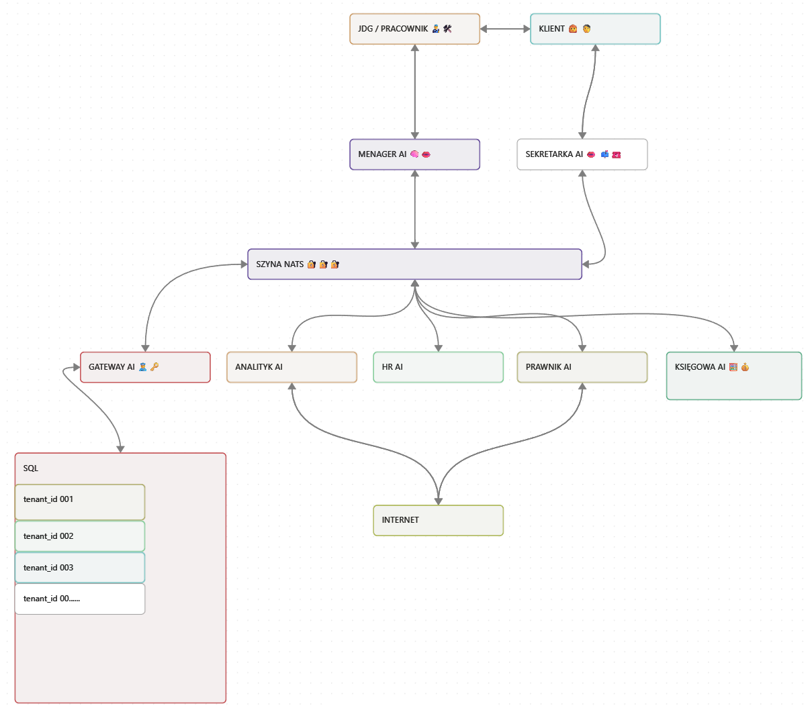

# Adrian Musioł

Programista w obszarze AI, automatyzacji i analizy danych. Buduję systemy oparte na agentach LLM, integracje przez API oraz narzędzia do pracy z danymi. Dostępny do zleceń freelancerskich realizowanych zadaniowo.

[E-mail](mailto:info@abmusiol.com) · [LinkedIn](https://www.linkedin.com/in/adrian-musioł-a8a575367) · [Strona projektu ADYMUS](https://sites.google.com/abmusiol.com/ai-factory/strona-g%C5%82%C3%B3wna/projekt-adymus)

## Obszary pracy

| Obszar | Zakres |
|---|---|
| AI / LLM | Agenci wyspecjalizowani w jednej roli, praca z API modeli językowych |
| Automatyzacje | Workflow, integracje systemów, komunikacja asynchroniczna |
| Analiza danych | SQL, Python, przygotowanie i interpretacja danych |
| Narzędzia deweloperskie | Skrypty, usługi pomocnicze, integracje przez API |

## Technologie

- Języki: Python, JavaScript, SQL
- Frontend i prototypowanie: React, Angular, Streamlit, Figma
- Backend i komunikacja: FastAPI, REST API, WebSocket, szyna komunikatów NATS, Docker
- Dane: PostgreSQL (multi-tenant, RLS), Qdrant (baza wektorowa), Redis
- Głos: Porcupine, Faster Whisper, Piper
- Narzędzia: Git, GitHub

## Obecnie

- Zgłębiam temat AI governance: kontrola, nadzór i odpowiedzialność przy systemach AI (w ADYMUS m.in. zatwierdzanie operacji przez użytkownika).
- Pracuję w Figmie, Angularze, Reakcie i Streamlicie.

## Projekt główny: ADYMUS

Autorski system operacyjny dla mikroprzedsiębiorstw (JDG), sterowany głosem. Zastępuje klikanie w tradycyjnych systemach ERP komendami głosowymi, a pracę wykonują wyspecjalizowani agenci AI komunikujący się przez szynę NATS.

### Założenia architektury

- **Voice-first:** potok audio (redukcja szumu, wykrywanie słowa wywołującego, rozpoznawanie i synteza mowy) z docelowym opóźnieniem poniżej 800 ms.
- **Hub-and-spoke:** Menedżer orkiestruje zadania, agenci specjalistyczni (Sekretarka, Analityk, Księgowa, HR, Prawnik) tylko odpowiadają na zlecenia, co ogranicza pętle decyzyjne.
- **Human-in-the-loop:** zapis do bazy następuje wyłącznie po potwierdzeniu „TAK” przez użytkownika, a wykonuje go osobna bramka (HITL Gateway).
- **Multi-tenant:** izolacja danych firm przez `tenant_id` i Row Level Security w PostgreSQL.
- **Router intencji:** proste, powtarzalne komendy są mapowane na funkcje bez wywołania LLM, co obniża koszt i opóźnienie.
- **Kanały i multimodalność:** obsługa przez głos, WhatsApp i SMS oraz analiza zdjęć (np. zdjęcie pustej półki zapisuje brak w magazynie).
- **Strażnik (Guardian):** izolacja procesów i weryfikacja najważniejszych zmian przez człowieka.
- **Integracje:** GUS BIR1, Google Workspace, KSeF, Stripe, wyszukiwarka prawa, scraper cen B2B.

Więcej: [docs/adymus.md](docs/adymus.md) oraz [strona projektu](https://sites.google.com/abmusiol.com/ai-factory/strona-g%C5%82%C3%B3wna/projekt-adymus).

## Wykształcenie i certyfikaty

- **Pracuj w AI: Zostań Data Scientist od Zera**, GoTo IT (gotoit.pl), 24.09.2026.

## Doświadczenie

- Państwowa Straż Pożarna w Zabrzu, 1992–2004: strażak zawodowy, dowódca zastępu, technik pożarnictwa. Praca w warunkach wysokiej odpowiedzialności i pod presją czasu.
- Niemcy, 2008–2024: praca techniczna i produkcyjna (montaż, obróbka metali, obsługa sprzętu w straży pożarnej w Besigheim, produkcja w Deutsche Ölwerke Lubmin). Biegła praca w języku niemieckim.

## Współpraca

Model zadaniowy: ustalamy zakres, szacunek godzin i termin, potem realizuję zadanie z regularnym raportowaniem postępu. Kod trafia do repozytorium z historią commitów i opisem uruchomienia.

## Licencja

Treść tego repozytorium jest udostępniona na licencji [MIT](LICENSE).
